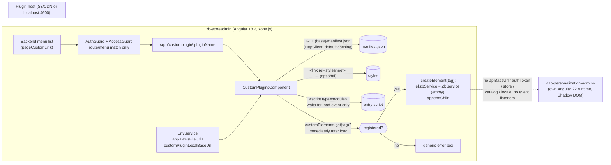

# ZenBasket dynamic plugin rendering — architecture & implementation audit

Audit date: 2026-11-11. Phase 1 (audit only): **no production code was changed** in either repository.

| | |
|---|---|
| Host audited | `zb-app` → submodule `apps/zb-storeadmin`, branch `ZB-PLUGINS-28-10-26`, HEAD `d19430659` ("fix: custom plugin admin changes"), working tree clean apart from `public/zb-bundles` |
| Plugin audited | this repo (Product Personalization), branch `refactor/dedicated-personalization-worker`, build in `dist/product-personalization/` (generated 2026-11-10 16:01) |
| Primary file | `apps/zb-storeadmin/src/app/apps/components/custom-plugins.component.ts` (394 lines; the whole feature is 4 small files + 1 route) |
| Evidence | Real Chrome 154 (headless) running the **unmodified** host component against the **real** `dist/` build, plus static reading. Harness: `docs/zb-plugin-loader-audit-harness/` |

**Verdict: NOT PRODUCTION READY.** The loader cannot render the Product Personalization admin element today, in either mode, even with a corrected manifest. Details and the ten required answers are in section 7.

---

## 0. How things were verified (and what that means)

Three evidence levels are used throughout. Nothing is reported as verified unless it was executed.

* **EXEC** – executed in real Chrome against real artifacts (run IDs `T1…`, `F1…`, `DEV1`, `P1`, `L1`, `L3`, `F9b`, `F11`, `F12`; see §8).
* **CODE** – established by reading source; behaviour follows directly from the code but was not executed.
* **N/T** – not tested; no access, or out of scope for this audit. These are listed, not guessed.

**How the host component was executed.** `custom-plugins.component.ts` was bundled **verbatim** with esbuild; only Angular's DI was stubbed (`inject()` returns fakes for `ActivatedRoute`, `HttpClient`, `EnvService`, `Renderer2`, `ChangeDetectorRef`; `HttpClient.get` is a `fetch` wrapper with the same success/error contract). The script/link injection, URL resolution, token logic and element creation are the real code, running in a real browser, with the host page on one origin and the "CDN" on another (cross-origin, as in production).

**Not executed / not possible here:** the real ZenBasket Store Admin (needs a remote backend login), the real CDN/S3 bucket and its headers, the plugin registry/menu backend, real Worker calls from the host, host type-check/lint. The host's only existing spec was run and **fails** (§5, L-test).

---

## Report A — Current architecture (from the actual code)

### A.1 Components and responsibilities

| File | Responsibility in the plugin lifecycle |
|---|---|
| `app.routes.ts:99` | Single route `app/customplugin/:pluginName` → lazy `CustomPluginsComponent`. Sits under `canActivate: [AuthGuardService]`, `canActivateChild: [AccessGuard]` (`app.routes.ts:50-51`). |
| `AccessGuard` / `AuthService.checkPermissions` (`auth/services/auth.service.ts:40-82, 120-135`) | The only authorization step. Matches the URL against the **backend-supplied menu list** (`pageCustomLink`), segment-by-segment (`:param` segments match anything). No menu match ⇒ denied. Pure client-side gating. |
| `custom-plugins.component.ts` | Everything else: base URL resolution, manifest fetch, style/script injection, registration check, element creation, mount, cleanup. |
| `custom-plugins.component.html/.scss` | Loader (`zba-loader`), error box, `div.custom-plugin-container` (100%/100%, `.hidden` while loading). |
| `models/custom-plugins.ts` | `PluginManifest { development: {storeadmin, storefront?}, production: {storeadmin, storefront?} }`; `PluginEntry { elementName, script, styles? }` — **the only manifest schema the host understands**. |
| `services/zb.service.ts` | Facade object assigned to the element as property `zbService`. **It is an empty class** (the only member is commented out). |
| `libs/zb-shared/.../env.service.ts:171-199` | Local env: `app:'local'`, `customPluginLocalBaseUrl: 'http://localhost:4600'`, `awsFileUrl: 'https://dev.images.getzenbasket.com/'`. In non-local envs `awsFileUrl` comes from the backend config response. |
| `storeadmin-interceptor.ts:88` | Admin JWT lives in `localStorage['jwt_token']` (host global — readable by any script on the page). |
| `custom-plugins.component.spec.ts` | One `should create` test with no providers. **Fails** (EXEC). |

Search of the whole repo found **no other** admin-side plugin loader, registry, menu registration, or CI/publish step for plugins. `grep` for `customplugin` finds only the route, env model and env service. (A separate, unrelated storefront loader exists: `libs/zb-shared/src/services/plugin/plugin-registry.service.ts`, classic "load script by URL" with no manifest — out of scope here.)

### A.2 Architecture diagram (as implemented)



### A.3 Execution sequence (as implemented)

```mermaid
sequenceDiagram
  participant R as Router/Guards
  participant C as CustomPluginsComponent
  participant H as HttpClient
  participant D as DOM (head / container)
  participant E as Plugin bundle
  R->>R: authenticated? menu link matches URL?
  R->>C: create (paramMap.pluginName)
  C->>C: resetState(); token = ++loadRequestId
  C->>C: base = local ? customPluginLocalBaseUrl : awsFileUrl + pluginName + "/"
  C->>H: GET manifest.json  (no timeout, no retry)
  H-->>C: manifest (unvalidated JSON)
  C->>C: entry = manifest.{development|production}.storeadmin
  C->>D: append <link> for each style (await all)
  C->>D: append <script type=module src=entry.script> (await load/error event)
  D->>E: execute entry module
  Note over E: store-admin.js calls loadAdmin() WITHOUT awaiting:<br/>import() main.admin → createApplication → customElements.define
  D-->>C: script "load" event (module evaluated, define() not yet run)
  C->>C: customElements.get(tag) → undefined → THROW
  C-->>R: setError("Failed to load the storeadmin element…")
  Note over E: ~50 ms later the tag IS defined (too late for this visit)
```

If `get(tag)` had succeeded: `createElement(tag)` → `el.zbService = …` → `appendChild` → `markReady()` (spinner hidden immediately; nothing waits for the element's own `admin-ready`).

### A.4 Lifecycle coverage (as coded)

| Stage | State |
|---|---|
| DISCOVER | Menu-driven (backend); loader has no registry call |
| AUTHORIZE | Menu/route match only (client side) |
| RESOLVE MANIFEST | Fixed `manifest.json` URL; no validation |
| LOAD | Script/link injection, de-duplicated by URL; no timeout/retry/integrity |
| REGISTER | Checked **once, immediately** (defective, see F-01) |
| CREATE | New element every mount (good) |
| CONFIGURE | Only `zbService` (empty). None of the plugin's real properties |
| MOUNT / READY | `appendChild` + spinner off; "ready" = appended |
| ACTIVE | No events consumed, no token refresh, no store/locale updates |
| UNMOUNT / CLEANUP | Element removed, style links removed, load token invalidated (good). Scripts intentionally kept |

---

## Report B — Missing / incorrect functionality matrix

Status legend: **I** implemented · **P** partial · **M** missing · **X** incorrect.

| ID | Feature / Scenario | Current implementation | Missing / wrong behaviour | Impact | Priority |
|---|---|---|---|---|---|
| B-01 | Wait for Custom Element registration | **X** — `customElements.get()` right after script `load` (`:159`) | Plugin entries register asynchronously; must `await customElements.whenDefined(tag)` (with timeout). EXEC T2: loader fails, tag defined ~65 ms later; first visit fails, later visits succeed (F9) | Admin element **never renders on first load** | **P0** |
| B-02 | Manifest schema compatibility | **X** — expects `{development|production}.storeadmin.{elementName,script,styles}` | Shipped `MANIFEST.json` (`elements[]`, `entries{}`, `files[]`) is a different, build-inventory format and is **never fetched** (also different filename case). The hand-written `public/manifest.json` that *is* fetched uses key `file` (not `script`), names files that no longer exist (`main-IANLJLTN.js`, `main-M65YF5AB.js`) and the wrong storefront tag | Production load fails before any request (EXEC T1) | **P0** |
| B-03 | Development-mode contract | **X** — local mode loads `http://localhost:4600/main.js` of `ng serve` | `main.js` is the standalone app bootstrap (`bootstrapApplication(App)`), registers no element; throws NG05104 (`app-root` not found) inside the host (EXEC DEV1). The real dev contract (watch build of the element entry) is undocumented and has no script | Dev integration cannot work | **P0** |
| B-04 | Host→plugin configuration | **P** — only `zbService` (empty) | None of `apiBaseUrl`, `authToken`, `productCatalog`/`productSearchUrl`, `locale`, `readonly`, `persistence`, `allowedAssetOrigins`, `view`, `configId` are set. EXEC L1: element comes up in **browser-only IndexedDB mode** ("Saved in this browser only") | Silent data loss / cross-store data mixing (see T-01) | **P0** |
| B-05 | Trusted origin policy | **M** — `resolveUrl` returns any `http(s)://` URL as-is (`:170-175`) | A manifest can load script/CSS from any origin; no allow-list (EXEC F8: foreign-origin script executed in host) | Privileged-code injection if any manifest/bucket is writable by a non-platform party | **P0** |
| B-06 | `pluginName` validation | **M** — route param concatenated into URL (`:106`) | `..`, `a/../../x` resolve outside the plugin folder (EXEC F10). Partly masked by AccessGuard segment-count matching (CODE) | Path escape within the same origin | **P1** |
| B-07 | Plugin events | **M** — no `addEventListener` anywhere | `admin-ready`, `admin-error`, `config-published`, `mapping-changed`, `view-change`, `config-saved` are ignored. `admin-ready` fired in EXEC L1 with nobody listening | Plugin errors invisible; no host reaction to publish/mapping | **P1** |
| B-08 | Error diagnostics | **P** — `catch (err)` discards the error (`:126`); 4 different failures give the identical message (EXEC F3/F4/F5/F7) | No `console.error`, no Rollbar (env has a key), no cause code | Support cannot triage | **P1** |
| B-09 | Timeouts / retry | **M** | Manifest fetch, script load, registration have no timeout; a hung CDN shows the spinner forever (CODE) | Infinite spinner | **P1** |
| B-10 | Store / user / token lifecycle | **M** | Loader is keyed only by `pluginName`. Nothing reacts to store switch, logout, token refresh | Wrong-store session after switch (N/T on real host) | **P1** |
| B-11 | Tag-conflict detection | **M** | Two different bundles claiming one tag → second reported **READY** while rendering the first's code (EXEC F9b) | Wrong plugin rendered silently | **P1** |
| B-12 | Manifest validation | **M** | Only `script`/`elementName` truthiness is checked (`:148`); types, URLs, duplicates unchecked | Obscure failures | **P1** |
| B-13 | Integrity (SRI) | **M** | `MANIFEST.json` carries SHA-256 per file but nothing consumes it; no `integrity`/`crossorigin` on injected tags | Tampered CDN file not detected | **P1** (P0 if third-party code is ever allowed) |
| B-14 | Versioned/atomic deployment | **M/N/T** | Loader fetches `{awsFileUrl}{name}/manifest.json`; unhashed `store-admin.js` and `manifest.json` are the mutable pointers. No version pin, no rollback path in code | Mixed-version / broken lazy chunks during deploys | **P1** |
| B-15 | CSP | **M** | No CSP header/meta found in `index.html` or `server.ts` (CODE). Not a loader bug, but plugin code runs fully privileged | Defence in depth absent | **P2** |
| B-16 | Layout contract | **P** | Host never sets `--zb-admin-height`; element defaults to `height:100vh; min-height:480px`. Real fit inside Store Admin shell N/T | Double scroll / overflow likely | **P2** |
| B-17 | Deep-linking / nested view | **M** | Host route only carries `pluginName`; no mapping to element `view`/`configId`/`order-id`, no reaction to `view-change`. Plugin uses an in-memory router (by design) so no history clash | Refresh always lands on `list`; no shareable links | **P2** |
| B-18 | Automated tests | **X** | Only spec fails (no providers) and asserts nothing about loading | No regression safety | **P1** |
| B-19 | Multi-instance / placements | **M** | One container, one element, full-page only; plugin itself warns "use one element per page" | Widgets/panels unsupported | **P3** |
| B-20 | Untrusted third-party model | **M** | No isolation of any kind | Only acceptable for first-party code | **P3** (decision needed) |
| B-21 | Style leakage in dev mode | **X** | Loader attaches the standalone app's global `styles.css` (36.9 kB incl. `html, body, :root` rules) to the host head (EXEC DEV1 shows the `<link>` attached; visual effect N/T) | Host UI restyled in dev | **P2** |
| I-01 | Per-mount fresh element; destroyed element never reused | **I** | EXEC L3: 15 mounts → 15 distinct instances | — | — |
| I-02 | Stale-load protection (`loadRequestId`) and destroy-during-load | **I** | EXEC F11/F12: slow plugin A did not populate plugin B's page; destroy during manifest fetch injected nothing | — | — |
| I-03 | Script/link de-duplication; style cleanup on leave | **I** | EXEC L3: exactly one `<script>` after 15 mounts | — | — |
| I-04 | Controlled error UI for manifest 404/invalid JSON/entry 404/HTML-as-JS/CSS 404 | **I** (message is generic) | EXEC F1,F2,F4,F5,F7 | — | — |
| I-05 | Plugin-side: guarded registration, Shadow DOM, zoneless, in-memory router, no global listeners, own asset base | **I** (plugin) | `main.admin.ts:1-95`; EXEC L1 `hasShadow:true`, no `<style>` added to host head | — | — |

---

## Report C — Failure scenario analysis

Every item is reproducible with the harness (`docs/zb-plugin-loader-audit-harness/`) unless marked CODE.

### C-1 Admin element never renders on first load (B-01) — **P0**
* **Root cause:** `scripts/finalize-element.mjs:73-78` writes `store-admin.js` as `import { loadAdmin } from './main-….js'; loadAdmin();` — a fire-and-forget call. `loadAdmin()` → `import('./main.admin')` → `createApplication()` → `customElements.define()` (`main.admin.ts:64-88`) all happen after the module has already finished evaluating. The host (`custom-plugins.component.ts:155-161`) resolves on the script's `load` event and checks the registry immediately.
* **Reproduce:** harness `t1.mjs` run T2 (manifest corrected to `store-admin.js`): `tagDefinedNow:false`, `tagDefinedLater:true`; `t2.mjs` F9: visit 1 error, visits 2 and 3 succeed (first-visit-only failure is the most confusing symptom).
* **Component:** host loader (primary), plugin entry shape (contributing).
* **Impact:** Product Personalization can't be opened on a fresh page load. After one failed attempt it works until a full refresh.
* **Fix:** host awaits `customElements.whenDefined(tag)` raced with a timeout (e.g. 10 s). Optional plugin-side hardening: entry does top-level `await loadAdmin();` so `load` means "registered" — both together is best.

### C-2 Shipped manifest is unusable (B-02) — **P0**
* **Root cause:** two unrelated files. Host reads `…/manifest.json` (`production.storeadmin.script`). `public/manifest.json` (tracked, hand-written, last touched in `b4dc97b`; copied into `dist/` by the asset glob, `angular.json:71-79`) uses `file` and stale hashed names; `finalize-element.mjs:217-234` writes a *different* `MANIFEST.json` that the host never reads. On a case-insensitive file system (macOS/Windows) these two collide.
* **Reproduce:** run T1. The loader throws at `:148` (`script` missing), no network request is made for the entry; the message is the generic one.
* **Fix:** see Report E (one canonical manifest; host adapter).

### C-3 Development mode cannot mount (B-03, B-21) — **P0**
* **Root cause:** `customPluginLocalBaseUrl` points at `ng serve`; its `main.js` is `src/main.ts` (`bootstrapApplication(App)`), not the custom-element entry.
* **Reproduce:** `t3.mjs` (DEV1): `NG05104: The selector "app-root" did not match any elements`; the host also gets the app's global `styles.css` appended to `<head>`.
* **Not a CORS problem:** Vite's dev server echoes `Access-Control-Allow-Origin` for localhost origins (EXEC: curl with `Origin: http://localhost:4300`).
* **Fix:** the dev contract is a **watch build of the element entry + stable file server** (§E.2), not `ng serve`.

### C-4 Element runs with no host configuration (B-04) — **P0**
* **Root cause:** `injectElement` (`:318-325`) assigns only `zbService`. The element's inputs (`admin-element.component.ts:122-135`) all default to null/`list`; with no `apiBaseUrl`, persistence falls back to **local IndexedDB** (`customizer/services/local-db.ts:8`, DB `zb-personalizer`, not scoped by store/user).
* **Reproduce:** run L1: `elProps` all null, `events:["admin-ready"]` (no error), screenshot shows "Saved in this browser only (IndexedDB). Nothing is sent to a server."
* **Impact:** a merchant's templates would be saved to the browser, shared by every store/user using that browser origin, and never reach the Worker or the storefront.

### C-5 Arbitrary-origin code execution via manifest (B-05) — **P0 (security)**
* **Root cause:** `resolveUrl` (`:170-175`) passes absolute URLs through; no allow-list, no SRI.
* **Reproduce:** F8 — manifest `script` = `http://localhost:14800/evil.js`; the foreign script ran in the host page (the same origin that holds `localStorage['jwt_token']`).
* **Exposure depends on who can write the manifest.** In the local env `awsFileUrl` equals `awsImageUrl` (`env.service.ts:195-196`) — i.e. the *image* bucket. Whether the production `awsFileUrl` is the same merchant-writable bucket is **N/T** and must be confirmed.

### C-6 Silent wrong-plugin rendering on tag conflict (B-11) — **P1**
* F9b: plugin A registered the tag; plugin B (different URL, same tag) reports READY and renders A's implementation. The plugin's own guard (`main.admin.ts:45-62`) tolerates this by design, so the host is the only place it can be detected.

### C-7 Misleading errors (B-08), no timeout (B-09) — **P1**
* F3 (missing key), F4 (entry 404), F5 (HTML served as JS), F7 (CSS 404) all produce: *"Failed to load the storeadmin element for "…"*. F6 (lazy chunk 404) also shows this message but the real cause (an **unhandled promise rejection** inside the plugin entry, surfaced as `pageerror`) is invisible to the host. Hang: no timers exist in the component (CODE).

### C-8 `pluginName` path escape (B-06) — **P1**
* F10: `..` → `/manifest.json` at bucket root; `a/../../x` → `/x/manifest.json`. AccessGuard compares decoded segments (`auth.service.ts:48,129`) so an encoded `%2F` makes the segment count differ and the route is denied — but that is incidental, and a plain `..` segment has the right count.

### C-9 Deployment hazards (B-14) — **P1, CODE**
* Lazy chunks (the editor, dialogs and import/export live in chunks outside the initial graph) are fetched on demand through relative `import()`s. If a deploy removes old hashed chunks, a long-lived admin session that already loaded the old entry will fail on its next lazy import. If a new `manifest.json`/`store-admin.js` is published before its chunks, fresh sessions break. Nothing in the host or the publish flow (not in either repo) prevents this. Needs immutable versioned folders (Report E).

### C-10 Host spec fails (B-18) — **P1**
* `npx jest -c apps/zb-storeadmin/jest.config.ts …/apps` → `NullInjectorError: No provider for ActivatedRoute!` (1 failed).

---

## Report D — Product Personalization integration readiness

| Area | Dev | Prod | Notes (evidence) |
|---|---|---|---|
| Rendering | ❌ | ❌ | DEV1 NG05104; T1/T2 (first-visit race + manifest mismatch) |
| Manifest compatibility | ❌ | ❌ | Host reads `manifest.json`/`production.storeadmin.script`; plugin ships `MANIFEST.json` (tag+entry per element, files, sha256, roles, entry download graph) and a stale hand-written `manifest.json`. The loader consumes none of `files`, `sha256`, `roles`, `entries.*.initialFiles` (CODE: it only reads `script`, `elementName`, `styles`) |
| Correct element chosen (admin, not storefront) | ✔ by schema | ✔ by schema | Host selects `.storeadmin`. EXEC P1: the admin entry downloads 6 requests — `manifest.json`, `store-admin.js`, `main-EN3ADEH5.js`, and 3 chunks — **none of the storefront chunks**. `MANIFEST.json` initial graph: 558 000 B admin vs 417 515 B storefront (build artifact, not a browser measurement) |
| Asset loading (CSS/fonts) | n/a | ✔ plugin-side | Shadow DOM, no CSS file needed (no host `<style>` added, EXEC L1); fonts/images resolve from the script's own URL via `setAssetBaseUrl(import.meta.url)` — cross-origin font loading from a real CDN is **N/T** |
| Authentication | ❌ | ❌ | `authToken` never set. Do **not** forward the admin session JWT (HS256, carries the whole user record, uses `clientId` not `store_id` — see memory note on the POC). A backend-minted short-lived store-scoped token is required |
| Store context | ❌ | ❌ | Worker derives store from token claims; host sends none |
| API connectivity | ❌ | ❌ | `apiBaseUrl` not set ⇒ IndexedDB mode (L1). Worker CORS allow-list must include the Store Admin origin (N/T) |
| Navigation | P | P | Element uses an in-memory router (no host history clash — by design, CODE). Host does not map `view`/`configId`/`order-id` nor consume `view-change` |
| Lifecycle cleanup | ✔ | ✔ | Fresh instance per mount (L3: 15/15 distinct), element removed on destroy, style links removed; a 15-cycle run grew the heap ~1.1 MB after GC (incl. one-time init) — **not enough to claim or rule out a leak**; the plugin additionally warns when several instances coexist (observed only because my harness left one element mounted) |
| Error handling | ❌ | ❌ | `admin-error` never subscribed |

**Readiness: not ready.** The plugin side is in good shape (guarded registration, isolation, lazy chunks, documented contract); the gaps are almost entirely on the host loader and the manifest hand-off.

---

## Report E — Recommended architecture

Principle: keep the existing route/component/model; change what is wrong, add only what is necessary.

### E.1 Mandatory (before any production use)

1. **Registration wait.** After `loadScript`, `await Promise.race([customElements.whenDefined(tag), timeout(10 s)])`; on timeout report "registered no element `<tag>`". Plugin side: `store-admin.js`/`storefront.js` → top-level `await loadAdmin()` (both fixes are compatible).
2. **One canonical manifest.** Don't invent a third schema. Recommended: the host consumes the **generated** `MANIFEST.json` (it already has `elements[{tag,entry}]`, per-entry `initialFiles`, sha256) and the hand-written `manifest.json` is deleted. Only *genuinely missing* field: which surface an element belongs to — add `"surface": "storeadmin" | "storefront"` per element (today the host would have to infer it from the tag name). Small optional additions: `apiVersion` (host/plugin contract), `version` (to build the versioned base path). Keep `entry`, `tag`, `files[].sha256` as they are. A host-side adapter must also keep accepting the legacy `{development, production}` shape until all plugins migrate (compatibility).
3. **Config contract on the element, set as JS properties before `appendChild`:** `apiBaseUrl`, `authToken`, `persistence = 'cloud'` (fail closed — never rely on the IndexedDB fallback inside ZenBasket), `productSearchUrl` (preferred over a full `productCatalog`), `locale`, `readonly` (from the user's permissions), `allowedAssetOrigins`. `authToken` is re-read by the element on each request, so the host assigns a refreshed token on refresh.
4. **Tenant scoping.** Token from a backend endpoint (short-lived, store-scoped; not the admin JWT). Destroy and recreate the element on store switch, user change, logout and token-refresh failure. Server-side isolation is the Worker's job and must stay independent of the front end (verified in the Worker work earlier; not re-audited here).
5. **Origin allow-list + `pluginName` validation.** `^[a-z0-9][a-z0-9-]{0,62}$`; resolve every URL against the *manifest's* URL and require its origin to be in a configured set (`awsFileUrl` origin; `localhost` only when `app === 'local'`). Reject anything else. Confirm the production `awsFileUrl` bucket is **not** merchant-writable (see C-5).
6. **Diagnostics.** Typed errors (`MANIFEST_FETCH`, `MANIFEST_INVALID`, `SCRIPT_LOAD`, `NOT_REGISTERED`, `TIMEOUT`), `console.error` + Rollbar with the cause, user-facing text per cause.
7. **Dev contract (replaces `ng serve`).** `npm run watch:element` in the plugin repo = element `development` watch build + re-run `finalize-element.mjs` on each rebuild, served by `scripts/serve-static.mjs --cors` on a port that does not collide (default `serve:element` uses 4300, the Store Admin dev port). Local manifest/adapter points at `http://localhost:<port>/store-admin.js`. Document that plain `ng serve` is for standalone plugin development only.

### E.2 Recommended

* Events: subscribe to `admin-error` (surface + log), `admin-ready`, `config-published` / `mapping-changed` (host refresh / snackbar), `view-change` (optional URL sync via a query param); remove listeners on destroy.
* `markReady()` after `admin-ready` (or timeout), not after `appendChild`.
* Timeouts, one retry with cache-bust for chunk errors, optional `modulepreload` of the initial graph (`MANIFEST.json` already lists it).
* SRI: convert the manifest's hex SHA-256 to `sha384-…` base64 or add `integrity` to the manifest; apply to the entry script and preloads; add `crossorigin="anonymous"`.
* Tag-conflict check: before loading, if `customElements.get(tag)` exists and the script URL differs from the one that registered it, fail with `TAG_CONFLICT`.
* Deployment: immutable versioned folders `plugins/<name>/<version>/…` (`Cache-Control: public, max-age=31536000, immutable` for hashed files, short TTL for `store-admin.js`), plus a tiny pointer `plugins/<name>/manifest.json` (`no-cache`) that names the active version; publish order: files → pointer; keep the previous N versions so old sessions and rollbacks keep working; rollback = re-point.
* A CSP for Store Admin (`script-src` limited to the platform origin + approved plugin origin(s)).
* Replace the failing spec with a TestBed suite using `HttpTestingController` + a fake element, and promote the harness (`docs/…-harness`) to a CI browser test.

### E.3 Future

* Placements beyond full-page (dashboard widgets, order-detail panels) via a `placement` field and a generic slot component; multi-instance (instance id, per-instance token).
* Untrusted third-party plugins: Shadow DOM is **not** a JS sandbox — plugin code shares `window`, `localStorage['jwt_token']`, cookies, and the customElements registry. If third parties are ever allowed, the model has to change to **sandboxed iframes** (`sandbox` without `allow-same-origin`, separate origin) with a `postMessage` bridge and per-plugin scoped tokens. Not justified for first-party plugins; do not build it now.
* Plugin registry service (separate service per the platform design) providing the list, enable/install state and version per store; the menu would then be generated from it rather than from hand-entered `pageCustomLink`s.

---

## Report F — Implementation action plan

| Phase | Task | Priority | Files affected | Dependencies | Acceptance criteria |
|---|---|---|---|---|---|
| 0 Decisions | Decide trust model (first-party only vs third-party); canonical manifest file/schema; production `awsFileUrl` writability; who mints plugin tokens | P0 | decision doc | platform + storeadmin + our team | Written decisions; schema example agreed |
| 1 Loader correctness | `whenDefined` + timeout; typed errors + logging; manifest validator + legacy adapter; `pluginName` validation; timeouts | P0 | `custom-plugins.component.ts`, `models/custom-plugins.ts` (+ new small `plugin-loader` util) | 0 | Harness T2, F3–F7, F10 pass with distinct errors; first visit succeeds; invalid names rejected |
| 1p Plugin entry | top-level `await` in generated entries; emit canonical manifest incl. `surface`; remove `public/manifest.json` | P0 | `scripts/finalize-element.mjs`, `public/manifest.json`, `docs/…` | 0 | `dist` contains exactly one manifest; entry `load` implies tag defined |
| 2 Config & tenancy | Set element props before append; backend token endpoint; `persistence='cloud'`; recreate element on store/user/token change; logout teardown | P0 | `custom-plugins.component.ts`, `zb.service.ts` (replace empty facade with a typed context), auth/store services, backend endpoint | 1, platform team | L1 shows `apiBaseUrl`/`authToken` set, no IndexedDB mode; store switch re-mounts with new token; Worker rejects cross-store token |
| 3 Security | Origin allow-list; SRI + `crossorigin`; tag-conflict detection; CSP; confirm bucket not merchant-writable | P0/P1 | loader util, `server.ts`/`index.html`, infra | 0, 1 | F8 rejected; conflicting tag rejected; CSP report-only clean |
| 4 Events & UX | Subscribe/clean up events; `markReady` on `admin-ready`; error/empty states; height contract (`--zb-admin-height`) | P1 | component + scss | 2 | `admin-error` shown + logged; no double scroll at 1280×800 and 375×812 |
| 5 Dev contract | `watch:element` script; local manifest/adapter; doc; port fix | P1 | `package.json`, `scripts/`, README, env | 1p | Edit plugin source → rebuilt → host shows change; no NG05104 |
| 6 Deployment | Versioned immutable folders, pointer manifest, cache headers, publish order, rollback runbook | P1 | CI/CD (not in either repo), `finalize-element.mjs` | 0, 1p | Deploy with new chunks + old session continues; rollback restores old version without rebuilding Store Admin |
| 7 Tests | Replace host spec; add browser harness to CI; contract tests against real `dist` | P1 | `*.spec.ts`, CI | 1–5 | Matrix rows currently "Fail" turn "Pass" in CI |
| 8 Future | Placements, multi-instance, sandbox decision, plugin registry | P3 | new | 0 | per design doc |

---

## 5. Test matrix

Result key: **Pass** / **Fail** / **N/T** (not tested). Evidence IDs refer to §8; `file:line` are in the host repo unless prefixed `pp:` (this repo). 148 rows (every category meets or exceeds the required minimum). Counts below are by each row's primary result.

### Development application integration (9 rows)
| ID | Scenario | Expected | Actual | Result | Evidence |
|---|---|---|---|---|---|
| D-01 | Load `ng serve` entry (`main.js`) as the plugin | Custom element registered and mounted | Not registered; `NG05104 app-root not found` | **Fail** | DEV1; `pp:src/main.ts:1-5` |
| D-02 | Embedded vs independent | Mounted inside the container | Standalone app targets `<app-root>`, absent in host | **Fail** | DEV1 |
| D-03 | Angular bootstraps more than once | No second bootstrap in host | Second `bootstrapApplication` attempted inside host page (throws) | **Fail** | DEV1 |
| D-04 | Style isolation | Plugin CSS does not touch host | Standalone global `styles.css` (36.9 kB, `html, body, :root`) appended to host head; visual effect not measured | **Fail** (attachment) / visual N/T | DEV1 + `devbuild/styles.css` |
| D-05 | Host routing vs plugin routing | No interference | Not reachable (bootstrap fails) | **N/T** | — |
| D-06 | Browser refresh in dev | Re-loads plugin | Loader re-runs, same failure | **Fail** | DEV1 |
| D-07 | HMR effect on host | None / controlled | HMR client is injected only in `ng serve`'s `index.html`, not loaded by host | **N/T** | CODE only |
| D-08 | Auth available to dev app | Token provided | Nothing is passed | **Fail** | `:320` |
| D-09 | Dev behaves like prod | Same contract | Different entry (`main.js` vs `store-admin.js`), different manifest keys | **Fail** | `models/custom-plugins.ts`, `pp:public/manifest.json` |

### Production Web Component loading (12 rows)
| ID | Scenario | Expected | Actual | Result | Evidence |
|---|---|---|---|---|---|
| P-01 | Shipped `dist` as-is | Admin element renders | Error before any entry request (key `file`, stale hashes) | **Fail** | T1 |
| P-02 | Manifest corrected to `store-admin.js` | Renders | Error; tag undefined at check time, defined ~65 ms later | **Fail** | T2, P1 |
| P-03 | Entry = hashed façade `main-*.js` | Renders | Not registered (façade exports loaders, never calls them) | **Fail** | T3 |
| P-04 | Loader waits for script execution | Yes | Waits for `load` only | **Pass** (partial) | `:186-229` |
| P-05 | Loader waits for registration | Yes | No — immediate `get()` | **Fail** | `:159`, T2 |
| P-06 | Runtime chunks available | Static + lazy chunks resolve | 5 JS files fetched correctly from CDN origin | **Pass** | P1 |
| P-07 | Dynamic imports resolve against entry URL | Yes | Yes | **Pass** | P1 |
| P-08 | CSS & fonts | Element self-contained | No CSS needed; fonts cross-origin on real CDN | **Pass** (CSS) / fonts **N/T** | L1 |
| P-09 | Config set before mount | Yes | Only `zbService` | **Fail** | `:320`, L1 |
| P-10 | Element created from registered tag name | Yes | Yes (when registered) | **Pass** | L1 |
| P-11 | Renders after navigation/refresh | Yes | Fails on first visit, works afterwards in same page | **Fail** | F9 |
| P-12 | Destroyed correctly on leave | Yes | Element removed; style links removed | **Pass** | L3, `:388-393` |

### Manifest validation (16 rows)
| ID | Scenario | Expected | Actual | Result | Evidence |
|---|---|---|---|---|---|
| M-01 | Valid manifest (host schema) | Correct plugin loads | Loads only if tag registered synchronously | **Fail** (race) | T2 |
| M-02 | Manifest missing (404) | Controlled error | "Failed to load manifest.json…" | **Pass** | F1 |
| M-03 | Invalid JSON / HTML body | Controlled error | Same controlled message | **Pass** | F2 |
| M-04 | Required field missing | Validation failure | Generic "Failed to load the storeadmin element" (cause lost) | **Fail** (message) | F3, `:148` |
| M-05 | Entry file missing | Controlled error | Controlled, generic | **Pass** | F4 |
| M-06 | Lazy chunk missing | Controlled, attributed error | Loader error generic; real cause = unhandled rejection in plugin | **Fail** | F6 |
| M-07 | CSS missing | Error or documented fallback | Whole load fails, generic message, no fallback | **Pass** (controlled) / not documented | F7 |
| M-08 | Old-format manifest | Compatibility handling | None (no versioning in loader) | **Fail** | `models/custom-plugins.ts` |
| M-09 | Relative entry path | Resolves vs correct base | Resolved against `awsFileUrl+name/` (not against manifest URL); `..`-style paths unchecked | **Pass** (basic) | `:170-175` |
| M-10 | CDN returns 404 | Recoverable error | Controlled error, no retry | **Pass** (no retry) | F1, F4 |
| M-11 | CDN returns HTML instead of JS | Detect and report | Browser rejects (strict MIME); loader reports generic failure | **Pass** | F5 |
| M-12 | Unexpected origin in manifest | Block / policy | Executed | **Fail** | F8 |
| M-13 | Manifest changes mid-session | Version-consistent | No version tracking; script de-dup by URL | **N/T** | CODE |
| M-14 | Old cached manifest + new assets | No mixed versions | Not protected; depends on headers/folders | **N/T** | CODE |
| M-15 | Loader consumes `files`/`sha256`/`roles`/`entries` | Used or deliberately ignored | Ignored; `MANIFEST.json` never fetched | **Fail** | `:116,148-155` |
| M-16 | Manifest names tag for admin vs storefront | Distinguishable | `MANIFEST.json`: tag only, no surface; host schema: yes (`storeadmin`) | **Fail** (generated) | `pp:finalize-element.mjs:223` |

### JavaScript and chunk loading (10 rows)
| ID | Scenario | Expected | Actual | Result | Evidence |
|---|---|---|---|---|---|
| J-01 | Two plugins load simultaneously | Both load | Dedup by URL; tag race applies to each | **N/T** (race makes outcome moot) | CODE |
| J-02 | Different Angular versions | Independent | Plugin bundles own Angular 22 runtime; host Angular 18.2. Runtime coexistence in the real host | **N/T** | `package.json` of both |
| J-03 | Same plugin opened twice | One script | One `<script>` after 15 mounts | **Pass** | L3 |
| J-04 | Navigate away while loading | Nothing injected | Nothing injected | **Pass** | F12 |
| J-05 | Slow script finishes after navigation | Discarded | Token check before inject | **Pass** | F11, `:157` |
| J-06 | Chunk fails | Reported | Static graph fails → script error event (reported). Lazy chunk → unhandled rejection, loader reports generic error only because of race | **Fail** | F6 |
| J-07 | Script loads, tag never registered | Controlled error | Controlled (but indistinguishable from race) | **Pass** | F9b-prep/T3 |
| J-08 | Same tag from different bundles | Conflict detected | Silent, READY | **Fail** | F9b |
| J-09 | One plugin throws | Host unaffected | Host kept running; error is an unhandled rejection on `window` (would reach host global handlers) | **Pass** (isolation) / observability **Fail** | F6 |
| J-10 | Timeout/retry on script | Present | None | **Fail** | CODE |

### Plugin lifecycle (13 rows)
| ID | Scenario | Expected | Actual | Result | Evidence |
|---|---|---|---|---|---|
| L-01 | Initial load | Mounts | Fails first time (race) | **Fail** | T2 |
| L-02 | Reload/refresh | Mounts | Same as L-01 (new document) | **Fail** | F9 |
| L-03 | Navigate away | Cleaned up | Element + links removed, token invalidated | **Pass** | L3, `:388` |
| L-04 | Navigate back | Fresh element | New instance each time | **Pass** | L3 (15/15) |
| L-05 | Switch plugins | Old removed, new mounted | Reset + token logic correct | **Pass** | F11 |
| L-06 | Switch stores | Re-mount with new context | Nothing reacts | **Fail** (CODE) | no store subscription |
| L-07 | Logout | Unmount, drop credentials | Host navigates away (guard); loader has no hook | **N/T** | CODE |
| L-08 | Token expiry | Refresh token on element | No mechanism | **Fail** (CODE) | `:320` |
| L-09 | Plugin disabled/uninstalled | Block | Only if menu entry removed | **N/T** | `auth.service.ts:40-82` |
| L-10 | Host destroyed | Cleanup | `ngOnDestroy` OK | **Pass** | `:388-393`, F12 |
| L-11 | Repeated mount/unmount | No growth | 1 script, 15 distinct instances, +1.1 MB heap after GC (incl. init) — leak neither shown nor excluded | **Pass** (functional) / leak **N/T** | L3 |
| L-12 | Destroyed element reused | Never | Never (always `createElement`) | **Pass** | `:318` |
| L-13 | Owned listeners/timers/requests cleaned | Yes | Host adds none; HTTP subscription is unsubscribed on destroy but not cancelled on param change (old request completes, ignored) | **Pass** (minor) | `:110`, `:113` |

### Host–plugin communication (11 rows)
| ID | Scenario | Expected | Actual | Result | Evidence |
|---|---|---|---|---|---|
| C-01 | `apiBaseUrl` | Set | Not set | **Fail** | L1 |
| C-02 | `authToken` | Set | Not set | **Fail** | L1 |
| C-03 | `productCatalog` / `productSearchUrl` | Set | Not set | **Fail** | L1 |
| C-04 | `view`, `configId` | Command | Not set (element defaults `list`) | **Fail** | L1 |
| C-05 | `readonly`, `locale`, `allowedAssetOrigins`, `persistence` | Set | Not set | **Fail** | L1 |
| C-06 | Objects as JS properties (not attributes) | Properties | Mechanism correct (property assignment), nothing passed except `zbService` | **Pass** (mechanism) | `:320` |
| C-07 | Config before element becomes active | Yes | Never configured at all | **Fail** | `:318-325` |
| C-08 | Events subscribed | `admin-ready` etc. | No listeners | **Fail** | L1 (`admin-ready` fired unheard) |
| C-09 | Listener cleanup | Yes | n/a (none) | **N/T** | — |
| C-10 | Error handling of `admin-error` | Surfaced | Not subscribed | **Fail** | CODE |
| C-11 | `zbService` is usable | Provide host capabilities | Empty class; plugin does not read it | **Fail** (useless) | `zb.service.ts:13-18` |

### Multi-tenant isolation (12 rows)
| ID | Scenario | Expected | Actual | Result | Evidence |
|---|---|---|---|---|---|
| T-01 | Plugin data persistence scoped to store | Cloud, token-scoped | Falls back to IndexedDB `zb-personalizer`, not store/user scoped | **Fail** | L1, `pp:local-db.ts:8` |
| T-02 | Current store identification passed | Yes | No | **Fail** | `:320` |
| T-03 | Token issuance for plugin | Short-lived store-scoped | None | **Fail** | — |
| T-04 | Token refresh | Yes | None | **Fail** | CODE |
| T-05 | Store switching mid-load | Stale responses dropped | Token logic is per route change only; store change not observed | **N/T** (real host) | CODE |
| T-06 | Switching after mount | Re-mount | Nothing | **Fail** | CODE |
| T-07 | Registry filtering by store | Server-driven | Backend menu (unverified) | **N/T** | — |
| T-08 | Install/enable check before render | Server-checked | Menu match only (client) | **N/T** | `auth.service.ts:40-82` |
| T-09 | Unapproved plugin via URL | Denied | Denied iff menu lacks a matching link; if the menu link uses `:pluginName`, any name passes (menu data unseen) | **N/T** | `:120-135` |
| T-10 | Backend tenant isolation | Server enforces | Worker derives store from token (previous work); host not audited here | **N/T** | memory/worker docs |
| T-11 | Plugin cache isolation | Per store | IndexedDB shared (see T-01) | **Fail** | L1 |
| T-12 | Logout cleanup | Cleared | IndexedDB left behind in local mode | **Fail** (CODE) | `pp:local-db.ts` |

### Authentication and security (13 rows)
| ID | Scenario | Expected | Actual | Result | Evidence |
|---|---|---|---|---|---|
| S-01 | Approved-origin enforcement | Yes | None | **Fail** | F8 |
| S-02 | Manifest URL validation | Yes | Built from env + unvalidated name | **Fail** | F10 |
| S-03 | Script integrity (SRI) | Yes | None (hashes exist, unused) | **Fail** | `:206-227` |
| S-04 | `crossorigin` on injected script | Set | Module scripts are CORS-fetched by default | **Pass** (implicit) | F8 cross-origin run |
| S-05 | XSS via error message | None | Interpolated into text (`{{ }}`), escaped | **Pass** | html:12 |
| S-06 | `innerHTML` use | Safe | Only `= ''` | **Pass** | `:316,368` |
| S-07 | Token exposure to plugin | Minimal | Plugin shares `localStorage['jwt_token']` with host regardless (same JS realm) | **Fail** (inherent) | `storeadmin-interceptor.ts:88` |
| S-08 | Untrusted plugin registration | Blocked | No registry check in loader | **Fail** | — |
| S-09 | CSP | Present | None found | **Fail** | `index.html`, `server.ts` |
| S-10 | Shadow DOM ≠ JS sandbox | Acknowledged | Confirmed: foreign script read host `localStorage` | **Pass** (finding) | F8 |
| S-11 | Sensitive data in error logging | None | Nothing is logged at all | **Pass** (accidental) | `:126` |
| S-12 | Supply chain (plugin deps) | Reviewed | `3rdpartylicenses.txt` ships; no audit run | **N/T** | — |
| S-13 | Plugin-side global side effects | None | No global listeners, memory router, no zone patch | **Pass** | `pp:main.admin.ts:1-12`, L1 |

### Routing and navigation (11 rows)
| ID | Scenario | Expected | Actual | Result | Evidence |
|---|---|---|---|---|---|
| R-01 | Open from menu | Route resolves | Route exists; menu content unseen | **N/T** | `app.routes.ts:99` |
| R-02 | Direct URL | Loads after auth | Guard first, then loader | **N/T** (real host) | `:50-51` |
| R-03 | Refresh | Re-loads | Re-runs loader (fails on first visit) | **Fail** | F9 |
| R-04 | Back/forward | Re-mount | `paramMap` re-fires; fresh element | **Pass** (CODE) | `:68-82` |
| R-05 | Deep link into plugin view | `view`/`configId` | Not supported | **Fail** | `:318-325` |
| R-06 | Route params | `pluginName` only | Works | **Pass** | `:70` |
| R-07 | Unknown plugin | Controlled error | Manifest 404 → controlled | **Pass** | F1 |
| R-08 | Disabled/deleted plugin | Blocked | Depends on menu | **N/T** | — |
| R-09 | Navigation before load finishes | Safe | Stale token logic | **Pass** | F11/F12 |
| R-10 | Host and plugin both control history | No | Plugin uses in-memory router | **Pass** (CODE) | `pp:main.admin.ts:73,22` |
| R-11 | `view-change` consumption | Optional | Ignored | **Fail** | — |

### UI and responsive layout (10 rows)
| ID | Scenario | Expected | Actual | Result | Evidence |
|---|---|---|---|---|---|
| U-01 | Container usable height | Defined | Wrapper `height:100%`; parent chain unknown | **N/T** | scss |
| U-02 | Element height | Fills container | Default `100vh`/min 480; host sets no `--zb-admin-height` | **N/T** (real shell) | `pp:admin-element.scss:13` |
| U-03 | Desktop render standalone | Renders | Rendered at 1280×800 in harness page | **Pass** | L1 screenshot |
| U-04 | Mobile/tablet | Responsive | Not tested | **N/T** | — |
| U-05 | Sidebar/header compat | OK | Real shell not run | **N/T** | — |
| U-06 | Modals/overlays/z-index | OK | Not tested | **N/T** | — |
| U-07 | Plugin CSS leaks into host | No | None (Shadow DOM, 0 `<style>` in head) | **Pass** | L1 |
| U-08 | Host CSS overrides plugin | No | Shadow DOM; inherited custom props only. Real host CSS not run | **Pass** (structural) | `pp:admin-element.component.ts:61` |
| U-09 | Loading / error states | Present | Loader + error box exist | **Pass** | html |
| U-10 | Focus/keyboard/a11y | AXE clean | Plugin has its own AXE tests; host integration N/T | **N/T** | `pp:tests/browser/admin-accessibility.spec.ts` |

### Performance and caching (9 rows)
| ID | Scenario | Expected | Actual | Result | Evidence |
|---|---|---|---|---|---|
| F-01 | Manifest request | 1 small request | 1 (`manifest.json`) | **Pass** | P1 |
| F-02 | Admin bundle size | Within budget | 558 000 B initial graph (budget warn 1.4 MB) — build artifact | **Pass** | `MANIFEST.json` |
| F-03 | Requests for admin entry | Few | 6 requests (manifest + 5 JS) | **Pass** | P1 |
| F-04 | Unrelated functionality downloaded | None | Storefront chunks not requested | **Pass** | P1 |
| F-05 | Time to registration | Low | ~65 ms on localhost (not a network-realistic figure) | **Pass** (local only) | P1 |
| F-06 | Memory | Stable | +1.1 MB after 15 cycles incl. init; inconclusive | **N/T** | L3 |
| F-07 | Caching headers / prefetch | Defined | Unknown (CDN not accessible); no preload in loader | **N/T** | — |
| F-08 | Duplicate Angular runtime | Understood | Plugin brings its own ~253 kB Angular chunk beside host's Angular 18 (by design) | **Pass** (documented) | `MANIFEST.json` |
| F-09 | Transfer size in real network | Measured | Cross-origin `encodedBodySize` = 0 in harness (no Timing-Allow-Origin) → not measured | **N/T** | P1 |

### Deployment and versioning (11 rows)
| ID | Scenario | Expected | Actual | Result | Evidence |
|---|---|---|---|---|---|
| V-01 | Publishing flow | Defined | Not in either repo | **N/T** | — |
| V-02 | Manifest publication | One canonical | Two conflicting files | **Fail** | C-2 |
| V-03 | CDN paths | `{awsFileUrl}{name}/` | Hard-coded convention | **Pass** (works as designed) | `:105-107` |
| V-04 | Versioned bundle paths | Yes | No version in path | **Fail** | `:106` |
| V-05 | Cache policy | Immutable hashed, short pointers | Unknown | **N/T** | — |
| V-06 | Immutable hashed assets | Yes | Build hashes chunks | **Pass** (build) | `dist/` |
| V-07 | Atomic deploy | Yes | Not enforced anywhere | **N/T** | — |
| V-08 | Rollback without rebuilding Store Admin | Yes | Possible only by overwriting CDN files (no pointer/version) | **Fail** (design) | — |
| V-09 | Plugin/host contract versioning | `apiVersion` | None | **Fail** | — |
| V-10 | Env separation | local/staging/prod | `app==='local'` branch only; others share `awsFileUrl` | **Pass** (basic) | `:94-98` |
| V-11 | Old session during deploy | Keeps working | Old lazy chunks may vanish | **N/T** (CODE risk) | C-9 |

### Multiple plugins and compatibility (11 rows)
| ID | Scenario | Expected | Actual | Result | Evidence |
|---|---|---|---|---|---|
| X-01 | Loader not hard-coded to one plugin | Generic | Generic: name from route, tag from manifest | **Pass** | `:70,148` |
| X-02 | Angular Custom Elements | Supported | Yes (when registered synchronously or awaited) | **N/T** (blocked by B-01) | — |
| X-03 | Lit / vanilla custom elements | Supported | Foreign-origin vanilla element rendered | **Pass** | F8 |
| X-04 | New plugin without code change | Yes | Yes, if manifest in host schema and route/menu exist | **Pass** (CODE) | `app.routes.ts:99` |
| X-05 | Plugin-specific assumptions | None | Assumes synchronous registration, one element, `storeadmin` surface, `zbService` | **Fail** | `:159,320` |
| X-06 | Two instances of same plugin | Supported | Plugin warns; host single container | **N/T** | L3 warns |
| X-07 | Different plugins side by side | Supported | Single container/route | **N/T** | — |
| X-08 | Full-page vs widgets | Distinguished | Full page only | **Pass** (scope) | html |
| X-09 | Host Angular 18 zone.js + plugin Angular 22 zoneless in one page | Works | Verified only without host Angular | **N/T** | — |
| X-10 | Tag collision across plugins | Detected | Silent | **Fail** | F9b |
| X-11 | Plugin failure isolates | Host and others continue | Loader state is per component; host continued | **Pass** | F6 |

Counts (computed from the rows above): 148 → **Pass 55 · Fail 58 · N/T 35**. A row with a split result (e.g. "Pass (CODE) / leak N/T") is counted by its first word. "Pass" always rests on execution or a direct code reading; things not executed are N/T.

---

## 6. Security trust model

| Model | Implication | Is the current design enough? |
|---|---|---|
| **First-party plugins only** (ZenBasket teams publish; platform controls the bucket and the registry) | Plugin code is as trusted as the host. Needed: origin allow-list, SRI, immutable versioned publishing, CSP, a store-scoped token (not the admin JWT), server-side tenant isolation. | Not today (B-05, B-13, B-04), but fixable incrementally in the existing architecture. |
| **Third-party plugins** (arbitrary developers) | The plugin can read `localStorage['jwt_token']`, call any admin API as the merchant, overwrite `customElements`, patch globals. Shadow DOM isolates CSS/DOM, **not JavaScript**. | No. Would need sandboxed cross-origin iframes with a `postMessage` bridge and scoped tokens. Don't build it until that business decision is made. |

---

## 7. Final answers

**Is ZenBasket's current dynamic plugin rendering implementation production-ready for loading independently developed Angular Web Components through a manifest-driven plugin architecture? → NOT PRODUCTION READY.**

Evidence: with the real Personalization build the admin element is **never rendered on a fresh page** (T1, T2, T3), the dev mode cannot work (DEV1), no configuration is passed (L1), and a manifest can execute code from any origin (F8).

1. **Render Angular development applications?** No. `ng serve`'s `main.js` is an app bootstrap (NG05104) and also attaches global CSS to the host. The usable dev contract is a watch build of the element entry (Report E §E.1-7).
2. **Render production-built Web Components?** Not reliably. Fails because the registry is checked synchronously (T2) and because the manifest the host reads does not match what the build produces (T1). After one failed visit the same page can mount it (F9) — which makes it look flaky, not working.
3. **Is the existing `MANIFEST.json` fully supported?** No — it is never fetched. It is a build-artifact inventory (files, sha256, roles, per-entry download graph) that happens to include a tag→entry list; the loader consumes none of its fields, expects a different schema (`development`/`production` → `storeadmin.script`) in a different file (`manifest.json`), and the one shipped under that name is stale.
4. **What happens when scripts, chunks or registration fail?** A generic error box appears for manifest 404/invalid JSON, entry 404, HTML-as-JS, CSS 404 and unregistered tags (good: controlled, no crash). But the cause is lost (error swallowed, not logged), there is no timeout/retry, and a lazy-chunk failure inside the plugin surfaces only as an unhandled rejection.
5. **Can multiple plugins run without conflicts?** Distinct plugins with distinct tags: probably (script dedupe works, F11/F12/L3), but only one element per route and no conflict detection when two bundles claim one tag (F9b).
6. **Is tenant isolation properly enforced?** Not by this feature. No store context or token is passed; the element falls back to browser-global IndexedDB (L1/T-01); store switch/logout aren't observed. Server-side isolation in the Worker is independent but was not re-audited here, and the real host/backends were not run.
7. **Can plugins be updated independently of ZenBasket?** Mechanically yes (URL + manifest), but without versioned folders, a pointer manifest, cache policy and retained old chunks it is unsafe (C-9); rollback = overwrite files.
8. **Lifecycle and navigation?** Unmount/cleanup, fresh element per mount, stale-load protection and script dedupe are correct (I-01…I-03). Missing: store/user/token changes, events, `view`/`configId` mapping, deep links.
9. **Mandatory before production:** E.1 items 1–7 — `whenDefined`; one canonical manifest + adapter; config/token contract with `persistence='cloud'`; store/logout re-mount; origin allow-list and name validation; typed errors/logging; real dev contract. Plus the Phase-0 decisions and confirmation that the production `awsFileUrl` bucket is not merchant-writable.
10. **Recommended order:** Phase 0 decisions → 1 (loader correctness) & 1p (entry/manifest) in parallel → 2 (config & tenancy) → 3 (security) → 4 (events/UX) → 5 (dev contract) → 6 (deployment) → 7 (CI tests) → 8 future. Phases 1 and 1p alone would make the element render; 2 is what makes it safe to use.

---

## 8. Evidence index (harness runs)

Harness: `docs/zb-plugin-loader-audit-harness/` (`README` there explains how to run). `t1.mjs` = T1–T3, `t2.mjs` = F1–F10, `t3.mjs` = DEV1, `t4.mjs` = P1, L1, L3, F9b, F11, F12.

| Run | What | Observed |
|---|---|---|
| T1 | Prod mode, real `dist/` as shipped | error "Failed to load the storeadmin element…"; no entry request (key `file`) |
| T2 | Prod, manifest rewritten to `store-admin.js` | `tagDefinedNow:false`, `tagDefinedLater:true`, error shown |
| T3 | Prod, manifest → hashed `main-EN3ADEH5.js` | tag never defined |
| DEV1 | Local mode vs dev build output (same files as `ng serve`) | `NG05104`, host head gets `styles.css`; no tag |
| F1 | manifest 404 | controlled error "Failed to load manifest.json…" |
| F2 | manifest = HTML | same controlled error |
| F3 | entry lacks `script` | generic error |
| F4 | entry 404 | generic error |
| F5 | entry served as `text/html` | browser strict-MIME error; generic loader error |
| F6 | lazy chunk 404 | generic error + `pageerror: Failed to fetch dynamically imported module` |
| F7 | `styles: [missing.css]` | whole load fails, generic |
| F8 | foreign-origin script in manifest | executed, element READY |
| F9 | 3 mounts in one page | visit 1 error, visits 2–3 ready |
| F9b | plugin B (different URL, same tag) | READY, renders A's implementation |
| F10 | odd `pluginName` | `..` → `/manifest.json`; `a/../../x` → `/x/manifest.json` |
| P1 | admin entry fetch list/timing | 6 requests, tag defined ~65 ms, no storefront chunks |
| L1 | mounted with only `zbService` | props all null, `admin-ready` only, "Saved in this browser only (IndexedDB)", Shadow DOM, 0 head `<style>` |
| L3 | 15 mount/unmount cycles | 15 distinct instances, 1 `<script>`, +1.1 MB heap after GC |
| F11 | A (slow manifest) then B | A's late result did not populate B's page |
| F12 | destroy during manifest fetch | nothing injected, no error |
| host spec | `jest … apps/` | 1 failed: `No provider for ActivatedRoute` |

**Limits of this evidence:** harness uses fetch-based `HttpClient` stand-in and a fake `Renderer2`; headless Chrome on localhost (timings are not network-realistic); the real Store Admin shell, backend menu, CDN headers and Worker were not exercised. Findings marked CODE should be re-checked by running them in the real host once the Phase-1 fixes are in.

---

## Addendum 2026-11-12 — what changed after this audit

Implemented (details and run instructions in `zenbasket-sdk-and-manifest.md`; verified with `t5.mjs`, harness section above):

* B-01 fixed in the host loader: the registration check is replaced by `customElements.whenDefined` with a 10 s timeout, and the element is created only afterwards (T2 now mounts on the first visit, ~150 ms on localhost).
* B-04 partly: manifest `config` is assigned to the element as properties before attach; `zbService` is now a real SDK (`auth`, `products`, `core`). The plugin gets its token from the SDK (mock) and refreshes it on 401.
* B-02 partly: `public/personalizedproduct/manifest.json` now matches the host schema with real tags, `store-admin.js` entry and `config`. The dev entries no longer point at `ng serve`.
* Still open from this report: B-03 (no watch build script), B-05/B-06 (origin allow-list, plugin-name validation), B-07 (events), B-09 (timeouts), B-10 (store switch), B-11/B-13/B-14 and the rest.
